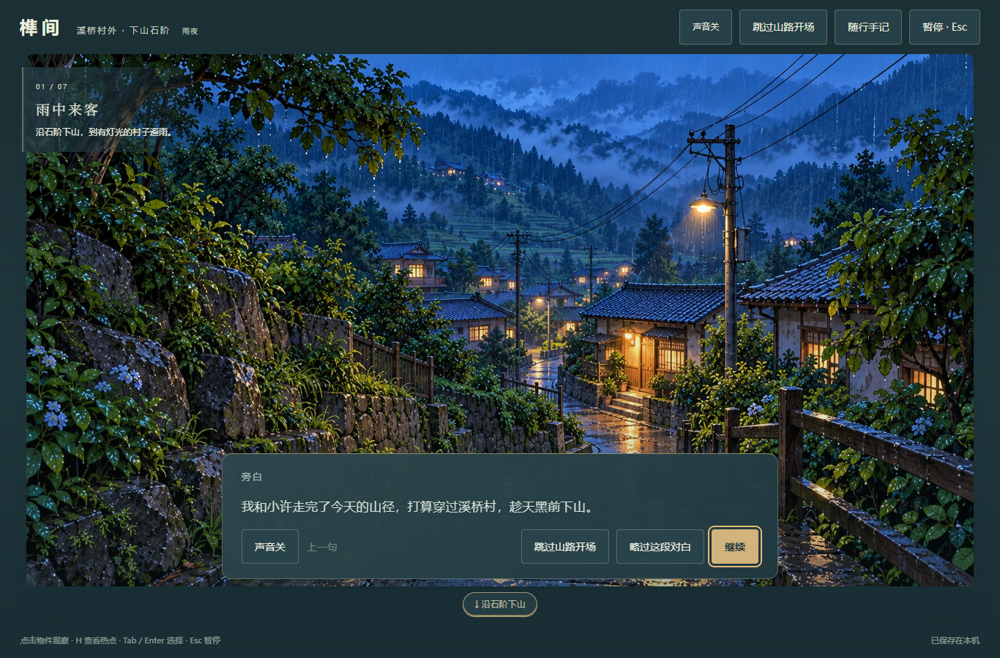

# 榫间 榫卯解谜游戏

以木作结构为主题的中文解谜游戏。玩家通过二维场景探索推进故事，在独立的三维特写中观察、拆解和装配木件。

**技术栈：JavaScript · Three.js · HTML/CSS · Node.js 测试 · Playwright**



## 当前内容

- 七章旅程：雨夜借宿、木作学习、取料修凳、返校练习、作品设计、参赛与结局。
- 以几何约束、碰撞检测和合法移动判断拆装过程，支持提示、撤销和重置。
- 自由练习与故事进度分开保存，支持本机存档、导出、恢复和旧存档迁移。
- 桌面键盘与指针交互，提供声音偏好和减少动态相关处理。
- 包含规则测试、状态恢复测试与浏览器流程测试。

故事中的人物、村落和比赛为虚构设定。项目是个人学习与创作实践，不作为真实木工工艺、结构安全或非遗身份的认证。

## 本地运行

需要 Node.js 22 或以上版本。从仓库根目录执行：

```bash
node scripts/serve.cjs
```

打开 `http://127.0.0.1:4173/?journey=1`。前端资源和 Three.js 已包含在 `dist/` 中，运行这个本地预览无需先安装开发依赖。自由练习入口为 `http://127.0.0.1:4173/?practice=1`。

端口被占用时，PowerShell 可这样指定其他端口：

```powershell
$env:PORT = '4174'
node scripts/serve.cjs
```

`dist/` 是直接维护的游戏源码和资源目录，请不要把它当成可删除的临时构建目录。

## 测试

核心规则测试只使用 Node.js 内置模块和仓库资源：

```bash
npm test
node tests/campaign-2d-state.test.cjs
node tests/continuation-state.test.cjs
```

浏览器测试需要安装开发依赖，并具备本机 Chrome。先启动本地服务，再运行：

```bash
npm install
node tests/mode-save-isolation.test.cjs
```

浏览器测试可使用 `TEST_URL` 指向另一端口。本次公开整理实际执行的范围见 [展示版本验证](docs/SHOWCASE_VALIDATION.md)，不把自动通过等同于首次玩家体验评价。

## 阅读入口

| 位置 | 内容 |
| --- | --- |
| `dist/puzzle-core.js` | 榫卯结构、合法移动、几何与碰撞规则 |
| `dist/campaign-data.js` | 主线状态、进度与恢复校验 |
| `dist/campaign.js` | 主流程交互、界面和场景协调 |
| `dist/campaign-story.js` | 对白和叙事条件 |
| `dist/game.js` | 三维特写、木件选择与拆装交互 |
| `tests/` | 规则、状态与浏览器测试 |

[当前状态与路线](docs/PROJECT_STATUS_AND_ROADMAP.md) · [历史开发记录](DEVELOPMENT_NOTES.md) · [首次试玩记录模板](docs/FIRST_PLAYTEST_TEMPLATE.md)

## 版本与素材

本展示版本整理自已有项目的已提交源码，保留历史开发说明；具体来源提交及整理后的修正记录见验证文档。素材和代码开发中使用了 AI 辅助，不将工具生成内容描述为全部手工完成。

Three.js 授权保留在 [`dist/vendor/THREE-LICENSE.txt`](dist/vendor/THREE-LICENSE.txt)，雨声素材记录见 [`docs/rain-0139-licenses.json`](docs/rain-0139-licenses.json)。未包含本地存档、Sites 账号配置、构建缓存和旧发布压缩包。
